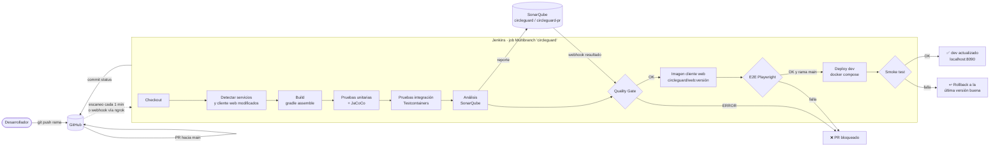
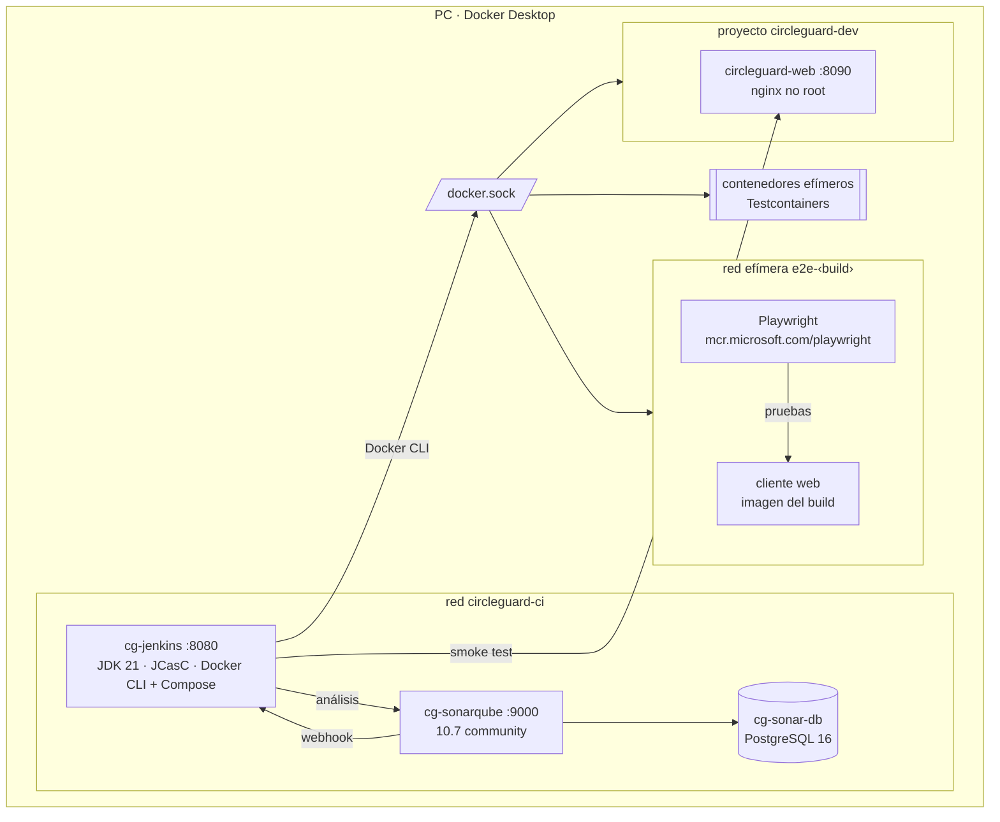

# Arquitectura del pipeline CI/CD

## Flujo de un cambio (Sprint 1 + Sprint 2)

En un PR el pipeline termina en las pruebas E2E: el check queda en verde o bloquea el merge.
Solo `main` despliega.

## Infraestructura local (Docker Desktop)

| Fase DevOps | Herramienta | Evidencia |
|-------------|-------------|-----------|
| Dev | Git + GitHub (GitHub Flow, Conventional Commits, `main` protegida) | PRs, historial |
| Build | Gradle 8.14 (wrapper), Java 21 · Docker (imagen web multi-stage) | JARs archivados, imagen `circleguard/web:<versión>` |
| Test | JUnit 5, Mockito, Testcontainers, JaCoCo · Playwright | Reportes JUnit, cobertura, reporte HTML de Playwright |
| Test (calidad) | SonarQube + Quality Gate bloqueante | Proyecto `circleguard` |
| Deploy | Docker Compose + smoke test + rollback | Contenedor `circleguard-web` en http://localhost:8090 |
